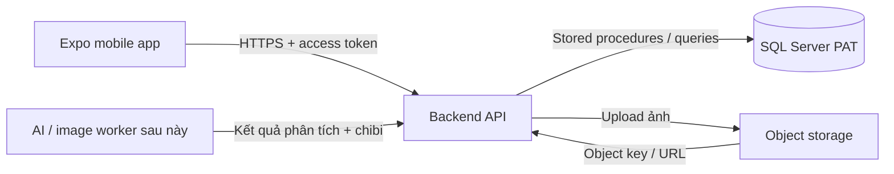
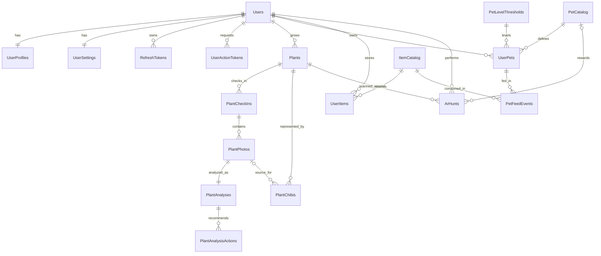

# PAT database (SQL Server / SSMS)

Thiết kế này bám theo state v2 của app mobile PAT: chăm sóc **cây thật** bằng ảnh check-in, phân tích tình trạng, tạo ảnh chibi, săn pet bằng AR và cho pet ăn để tăng EXP. Battle vẫn là `Coming Soon` nên chưa có bảng battle.

## Kiến trúc triển khai



SSMS chỉ dùng để tạo và quản trị SQL Server. App Expo **không kết nối trực tiếp** tới SQL Server; khi bỏ mock data, cần thêm backend API. Ảnh thật được upload vào object storage, còn database chỉ giữ object key, URL và metadata — không giữ URI `file://` trên điện thoại hay ảnh dạng base64/BLOB.

## Chạy trong SSMS

Yêu cầu SQL Server 2019+ và SQL Server Management Studio.

1. Mở SSMS và kết nối tới SQL Server local hoặc server dev bằng tài khoản có quyền tạo database.
2. Mở và chạy [01_pat_schema.sql](./01_pat_schema.sql). Script tự tạo database `PAT`, schema, bảng, index, view, stored procedure và role API.
3. Chạy [02_reference_data.sql](./02_reference_data.sql). Đây là dữ liệu hệ thống bắt buộc: luật level, danh mục pet và danh mục vật phẩm.
4. Tùy chọn: chạy [03_seed_demo.sql](./03_seed_demo.sql) để thêm tài khoản, cây, lịch sử check-in/phân tích, pet và kho đồ giống app hiện tại. Các object key ảnh `demo/...` chỉ là placeholder; script có thể chạy lại mà không reset tiến trình demo.
5. Chạy [04_smoke_test.sql](./04_smoke_test.sql). Thành công khi result cuối là `SMOKE_TEST_OK`; toàn bộ dữ liệu kiểm thử sẽ được rollback. Demo seed không bắt buộc cho bước này.
6. Refresh `Databases > PAT` trong Object Explorer.

Nếu tài khoản không có quyền `CREATE DATABASE`, hãy nhờ admin tạo database `PAT`, sau đó chạy lại script đầu tiên.

## Mô hình dữ liệu



| Nhóm | Bảng | Vai trò |
|---|---|---|
| Tài khoản | `auth.Users`, `auth.RefreshTokens`, `auth.UserActionTokens` | Định danh, mật khẩu đã hash, phiên đăng nhập, xác minh email và quên mật khẩu |
| Hồ sơ | `app.UserProfiles`, `app.UserSettings` | Hồ sơ, nhắc lịch, múi giờ, cài đặt AR/AI và thông báo Battle |
| Cây thật | `plant.Plants` | Cây của người dùng và snapshot streak riêng từng cây |
| Check-in | `plant.PlantCheckIns`, `plant.PlantPhotos` | Một mốc streak/cây/ngày, nhưng cho phép nhiều ảnh trong cùng ngày |
| AI/chibi | `plant.PlantAnalyses`, `plant.PlantAnalysisActions`, `plant.PlantChibis` | Ảnh gốc, kết quả phân tích, hướng dẫn và các phiên bản ảnh chibi tách rời |
| Pet | `game.PetCatalog`, `game.PetLevelThresholds`, `game.UserPets` | Danh mục pet, luật level và pet người dùng sở hữu |
| Kho đồ | `game.ItemCatalog`, `game.UserItems`, `game.PetFeedEvents` | Vật phẩm phục vụ pet, số dư và lịch sử cho ăn |
| AR | `game.ArHunts` | Lượt quét quanh một cây và pet nhận được |

## Quy tắc nghiệp vụ đã khóa ở database

- Streak là của từng cây. `UNIQUE (PlantId, CheckInLocalDate)` bảo đảm chỉ lần check-in đầu tiên trong ngày cập nhật streak; các ảnh tiếp theo vẫn được lưu cùng check-in.
- AR có đúng một lượt chung mỗi tài khoản/ngày nhờ `UNIQUE (UserId, HuntLocalDate)`, không phải một lượt cho mỗi cây.
- Vật phẩm không tác động lên cây. `game.usp_FeedPet` chỉ nhận item loại `FOOD`, trừ kho, cộng tổng EXP, tính level và ghi audit trong cùng transaction.
- Pet không có trạng thái no/vui vẻ/thân thiết. State tiến triển chỉ gồm quantity, level, tổng EXP và pet đồng hành.
- Mỗi cây chỉ có một chibi `IsCurrent = 1`; các bản cũ vẫn được giữ làm lịch sử.
- `ClientRequestId` làm khóa idempotency cho tạo cây, check-in, feed và AR, tránh nhân đôi khi mobile retry request.
- Ngày check-in/AR do server tính từ `UserSettings.TimeZoneId`; client không được tự quyết quota ngày.
- `rowversion` có trên các aggregate có thể chỉnh sửa để backend phát hiện cập nhật đồng thời.
- Demo có `HistoryComplete = 0`: mock hiện chỉ có snapshot streak nhưng thiếu toàn bộ lịch sử cũ, nên không được tính lại streak từ vài dòng lịch sử mẫu.
- Battle chỉ giữ `BattleNotifyEnabled`; chưa tạo bảng trận đấu, đội hình hoặc chỉ số chiến đấu.
- Cây đang được chọn để lướt trên màn hình chính vẫn là UI state cục bộ, không phải dữ liệu nghiệp vụ cần đồng bộ.

## Stored procedure và view dành cho API

Các thao tác ghi nên đi qua:

- `auth.usp_RegisterLocalUser`
- `auth.usp_IssueRefreshToken`, `auth.usp_RotateRefreshToken`, `auth.usp_RevokeRefreshToken`
- `auth.usp_CreatePasswordResetToken`, `auth.usp_ResetPassword`
- `app.usp_UpdateUserProfile`, `app.usp_UpdateUserSettings`
- `plant.usp_CreatePlant`, `plant.usp_UpdatePlant`, `plant.usp_SoftDeletePlant`
- `plant.usp_CreatePlantCheckIn`
- `plant.usp_CompletePlantAnalysis`
- `plant.usp_CompletePlantChibi`
- `game.usp_FeedPet`
- `game.usp_SelectCompanion`
- `game.usp_RecordArHunt`

Các màn hình chính có thể đọc từ:

- `app.vw_UserProfileSettings`
- `plant.vw_PlantDashboard`
- `plant.vw_PlantCheckInHistory`
- `plant.vw_PlantAnalysisActionHistory`
- `game.vw_PetCatalog`, `game.vw_ItemCatalog`
- `game.vw_UserPetCollection`
- `game.vw_UserItemInventory`
- `game.vw_ArHuntHistory`

Ví dụ kiểm tra nhanh dữ liệu demo:

```sql
USE [PAT];

DECLARE @DemoUserId UNIQUEIDENTIFIER = '11111111-1111-1111-1111-111111111111';

SELECT * FROM app.vw_UserProfileSettings WHERE UserId = @DemoUserId;
SELECT * FROM plant.vw_PlantDashboard WHERE UserId = @DemoUserId;
SELECT * FROM plant.vw_PlantCheckInHistory WHERE UserId = @DemoUserId;
SELECT * FROM game.vw_UserPetCollection WHERE UserId = @DemoUserId;
SELECT * FROM game.vw_UserItemInventory WHERE UserId = @DemoUserId;
```

## Lưu ý khi nối backend

- Tạo một SQL login/user riêng cho backend và chỉ thêm user đó vào role `pat_api_executor`; không dùng `sa` hoặc `db_owner` trong app.
- Hash mật khẩu ở backend bằng thư viện chuẩn (ví dụ `PasswordHasher` của ASP.NET Core Identity); các procedure auth chỉ nhận hash, database không nhận hoặc lưu mật khẩu thô.
- Chỉ lưu hash của refresh token. Access token không cần lưu trong bảng này.
- `auth.usp_GetLoginCredential` chỉ dành cho backend tin cậy; tuyệt đối không trả `PasswordHash` về mobile.
- Với quên mật khẩu, backend phải luôn trả cùng một thông báo chung cho client; cột `ShouldSend` từ procedure chỉ dùng nội bộ để tránh lộ email đã đăng ký.
- Upload ảnh thành công trước, sau đó gọi procedure check-in với `StorageObjectKey`. Chỉ lưu `PublicUrl` nếu đó là URL CDN ổn định; với bucket private, để cột này `NULL` và tạo signed URL ngắn hạn khi API trả dữ liệu.
- API lấy `UserId` từ access token, không tin `UserId` do request body gửi lên.
- Kết quả pet của AR phải do backend sinh; không nhận `CapturedPetId` trực tiếp từ mobile.
- UI hiện đang dùng mock/local state. Tài khoản `demo@pat.vn` trong seed là tài khoản dữ liệu mẫu, không có mật khẩu đăng nhập production.

Khi chuyển khỏi mock, giữ local storage của Expo làm cache/outbox. File ảnh `file://...` phải được upload trước; sau đó mới gửi object key cùng một `ClientRequestId` cố định lên API. Với dữ liệu seed hiện tại, giữ snapshot streak và `HistoryComplete = 0` thay vì tự dựng thêm lịch sử không có thật.

Nguồn model hiện tại được đối chiếu tại [types/app.ts](../mobile/src/types/app.ts) và [seed.ts](../mobile/src/data/seed.ts).
